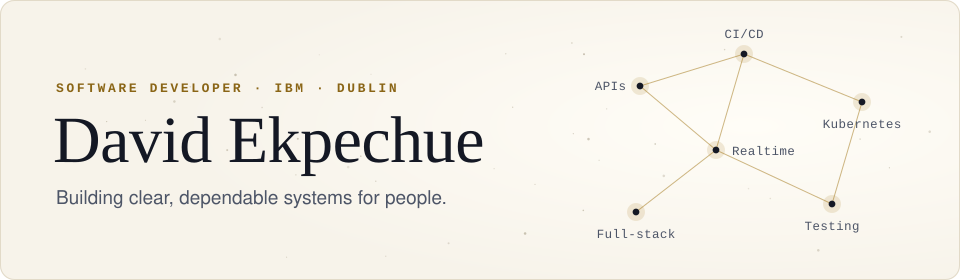
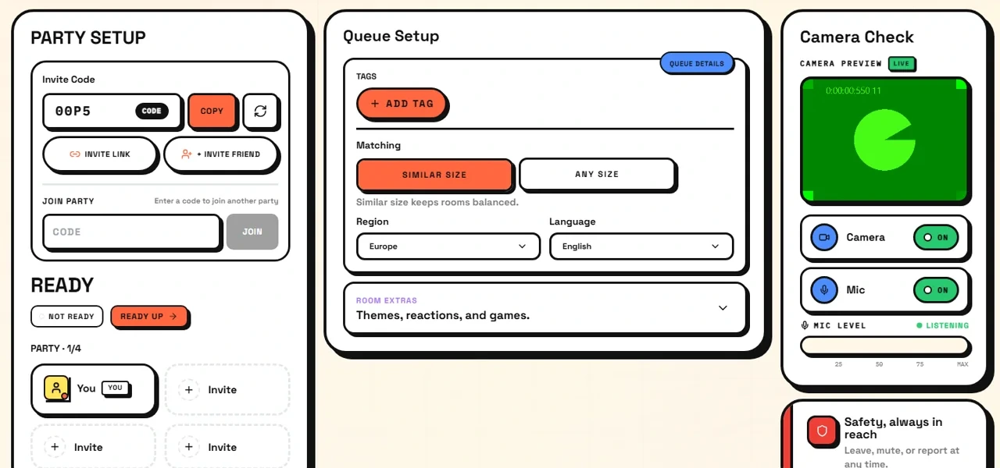
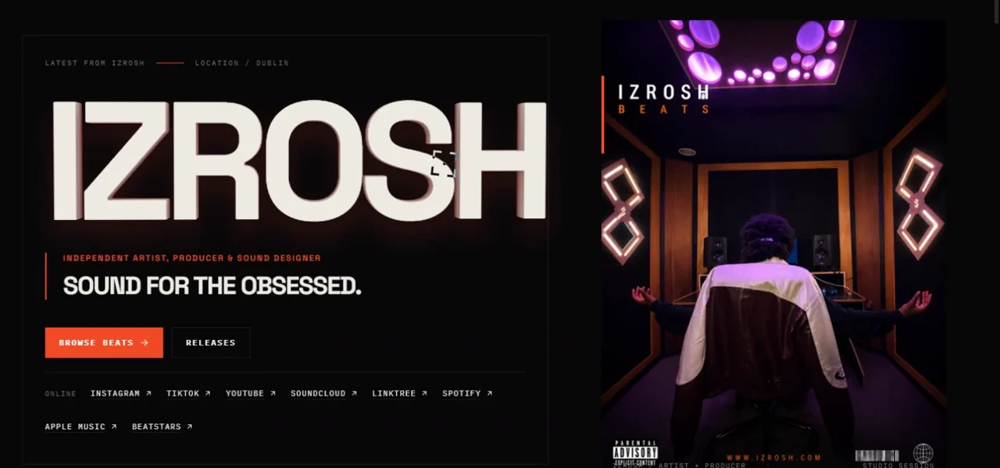
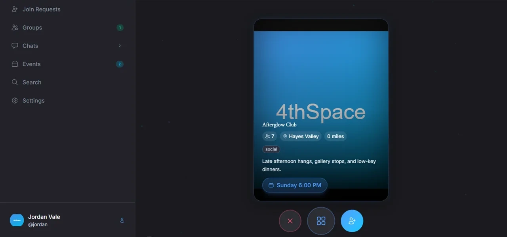

<picture>
  <source media="(prefers-color-scheme: dark)" srcset="assets/header-dark.svg">
  
</picture>

I'm a software developer at **IBM** in Dublin, working on API gateway products: API engineering, CI/CD pipelines, Kubernetes and OpenShift deployments, and automated testing. Outside work I design, build and run my own products end to end, from the database schema to the cluster they deploy on.

**[LinkedIn](https://www.linkedin.com/in/david-ekpechue-493124258/)** &nbsp;·&nbsp; **[Email](mailto:davidekpechue@gmail.com)** &nbsp;·&nbsp; **[minglr.live](https://minglr.live)** &nbsp;·&nbsp; **[izrosh.com](https://izrosh.com)**

## At IBM

**Software Developer** · June 2026 to present

- Build product features for IBM DataPower Interact Gateway across API engineering, CI/CD and automated testing, deployed to Kubernetes and OpenShift.
- Work on AI-assisted API generation in IBM API Connect: turning natural-language input into OpenAPI specifications, then validating and repairing the generated definitions.
- Write and maintain Jenkins pipeline stages covering build, integration and end-to-end tests, Docker images, cluster deployment, validation and cleanup.
- Joined full-time after a nine-month internship (January to September 2025) building backend API services in a large production codebase.

## Selected work

<table>
  <tr>
    <td width="52%" valign="top">
      
    </td>
    <td valign="top">
      <h3><a href="https://minglr.live">Minglr</a></h3>
      
<b>Group video chat with strangers, built for friends rather than dating.</b> A party queues together and is matched with another party, with interest tags, skip voting and room controls.

      <ul>
        <li>Self-hosted mediasoup WebRTC media service</li>
        <li>Presence and matchmaking on Redis and Socket.IO</li>
        <li>Moderation console and background workers, Playwright end-to-end tests, deployed to k3s</li>
      </ul>
      
<code>TypeScript</code> <code>React</code> <code>Node.js</code> <code>Express</code> <code>Prisma</code> <code>PostgreSQL</code> <code>Redis</code> <code>BullMQ</code> <code>mediasoup</code> <code>Docker</code> <code>Kubernetes</code>

    </td>
  </tr>
  <tr>
    <td width="52%" valign="top">
      
    </td>
    <td valign="top">
      <h3><a href="https://izrosh.com">IZROSH</a></h3>
      
<b>Storefront for an independent artist and producer.</b> Beat licensing, drum kits, releases and production services, with an admin backend for the catalogue.

      <ul>
        <li>Stripe webhook-driven fulfilment, with exclusive-beat reservation and late-payment handling</li>
        <li>Licence PDFs generated per purchase, delivered through signed private downloads</li>
        <li>Typed monorepo with zod schemas shared between API and web, tested with Vitest</li>
      </ul>
      
<code>TypeScript</code> <code>React</code> <code>Express</code> <code>Prisma</code> <code>PostgreSQL</code> <code>Redis</code> <code>Stripe</code> <code>S3</code> <code>Turborepo</code> <code>Docker</code>

    </td>
  </tr>
  <tr>
    <td width="52%" valign="top">
      
    </td>
    <td valign="top">
      <h3>4thSpace</h3>
      
<b>Group-first social discovery, in development.</b> People form groups, swipe on other groups by intention, match and chat.

      <ul>
        <li>Web and mobile clients over one shared API</li>
        <li>Geospatial discovery with PostGIS and Mapbox</li>
        <li>Search on MeiliSearch, realtime chat over Socket.IO, tested with Vitest and Playwright</li>
      </ul>
      
<code>TypeScript</code> <code>React</code> <code>React Native</code> <code>Expo</code> <code>Express</code> <code>Prisma</code> <code>PostgreSQL</code> <code>PostGIS</code> <code>Redis</code> <code>MeiliSearch</code>

    </td>
  </tr>
</table>

The source for these three is private. I'm glad to walk through the code and architecture on a call.

## Also

- **Dan & Dave's Webservices.** Production website for an Irish web studio serving trades and service businesses: services, pricing, care plans, contact flows and client demo sites, built as one Cloudflare Worker.
- **[Constellation portfolio](https://github.com/DavidEkpechue/personal-portfolio).** My portfolio as a force-directed knowledge graph, with the D3 simulation kept outside React's render loop.
- **Home lab.** An Ubuntu server running containerised services and game servers on Docker.
- **Games.** Roblox games in Luau and Godot prototypes in GDScript, including a modular mech arena with its own regression test suite.
- **Earlier work.** [Library Management System](https://github.com/DavidEkpechue/LibrayManagementSystem) in JavaFX, JDBC and MariaDB, and [Dino Game](https://github.com/DavidEkpechue/Dino-Game) in Pygame.

## Toolbox

<table>
  <tr><td><b>Languages</b></td><td>TypeScript, JavaScript, Java, Python, SQL, Bash</td></tr>
  <tr><td><b>Backend and APIs</b></td><td>Node.js, Express, REST, OpenAPI, IBM API Connect, Prisma</td></tr>
  <tr><td><b>Data and realtime</b></td><td>PostgreSQL, PostGIS, Redis, Socket.IO, mediasoup (WebRTC)</td></tr>
  <tr><td><b>Frontend and mobile</b></td><td>React, React Native, Expo, Vite</td></tr>
  <tr><td><b>Platform</b></td><td>Docker, Kubernetes, OpenShift, Jenkins, Linux</td></tr>
  <tr><td><b>Testing</b></td><td>Playwright, Vitest, integration and end-to-end testing</td></tr>
</table>

## Education

**B.Sc. (Hons) Computer Science**, Technological University Dublin, 2026. Second Class Honours, Grade 1 (2:1).

## Get in touch

The quickest way to reach me is [LinkedIn](https://www.linkedin.com/in/david-ekpechue-493124258/) or [email](mailto:davidekpechue@gmail.com). I'm based in Dublin, Ireland.
